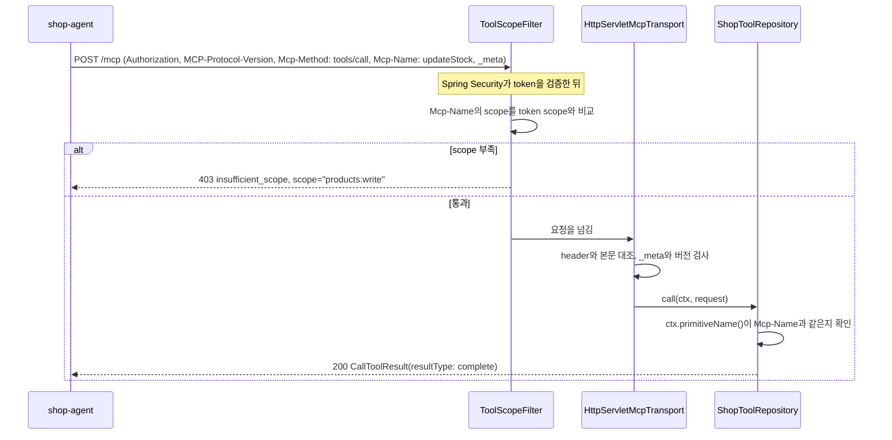

# MCP 2026-07-28 practice (`mcp-2026-07-28`) — 설계

## 목표

MCP 요청 형식을 2025-11-25에서 2026-07-28로 올린 practice와 학습 문서를 만든다.
2026-07-28에는 `initialize`와 session이 없다. client는 요청마다 `_meta`에 버전·capability·client 정보를 넣고, HTTP header 세 개(`MCP-Protocol-Version`, `Mcp-Method`, `Mcp-Name`)를 붙인다.
MCP Server는 MCP Java SDK 2.2.0-M1의 새 stateless 서버(`io.modelcontextprotocol.modern`) 위에 지금까지의 인가 장치를 그대로 얹는다.
web agent는 Spring AI `ChatClient`를 그대로 쓰고, MCP를 부르는 부분만 직접 만든 2026-07-28 client로 바꾼다.
독자는 안내서 1\~13장을 읽은 사람이다. 다 보고 나면 2026-07-28 형식의 MCP Server와 client가 인가를 어떻게 주고받는지 알게 된다.

최종 목표(2026-09-28 사용자 결정)로 가는 로드맵의 마지막 단계다.
로드맵: scope와 step-up(PR #6) → stateless와 handle(PR #11) → tool 목록과 권한(PR #14) → CIMD(PR #21) → **SDK 2.2(MCP 2026-07-28)로 올리기**.

**출발점(2026-10-17):** MCP Java SDK `v2.2.0-M1`(pre-release, 2026-10-16)에 2026-07-28 서버가 들어왔다. 같은 날 가능성 조사(spike)로 서버 쪽이 Spring Boot 4.1.1과 Spring Security 위에서 돌아가는 것을 확인했다.
SDK에는 아직 2026-07-28 client가 없고 일정도 없다. 그래서 web agent의 client는 직접 만든다(사용자 결정 B안).

## 결정

| # | 항목 | 결정 | 누가 |
|---|---|---|---|
| A | client 쪽 | agent에 2026-07-28 client를 직접 만든다. 서버는 2026-07-28만 받는다(두 형식을 함께 받는 dual-era 서버는 만들지 않는다) | 사용자 |
| B | 바탕 | `practice/mcp-cimd`를 복사한다. CIMD Authorization Server와 ChatGPT형·Claude형 client type을 그대로 가져가고, MCP Server와 agent의 MCP 호출만 바꾼다 | 사용자 |
| C | 실제 플랫폼 확인 | 우리 agent만으로 확인한다. Claude Code(CLI) 연결은 Authorization Server 변경(공인 인증서 신뢰, `localhost` redirect의 port 무시 비교)이 필요해 후속 작업으로 둔다 | 사용자 |
| D | client 범위 | 인가에 닿는 것만: 요청마다 `_meta`와 header 세 개, `server/discover`, `tools/list`·`tools/call`, `ttlMs`·`cacheScope`에 따른 token별 목록 cache, `403` step-up. MRTR, `subscriptions/listen`, `x-mcp-header`는 다루지 않는다 | 사용자 |
| E | client 구현 방식 | JSON 타입은 SDK의 `io.modelcontextprotocol.modern.McpSchema`·`JsonRpc`를 쓰고, transport(HTTP·header·`_meta`·응답 해석·오류 mapping)만 직접 만든다 | 사용자 |
| F | 이름 | `practice/mcp-2026-07-28`. Java package는 숫자로 시작할 수 없어 `dev.starryeye.modern.*`다 | 사용자 |
| G | 포트 | Authorization Server 9070, MCP Server 8181(`/mcp`), agent 8180, agent의 CIMD 문서 host `https://localhost:8182` | Claude |
| H | 버전 | Spring Boot 4.1.1. MCP Server는 Spring AI 없이 `io.modelcontextprotocol.sdk:mcp:2.2.0-M1`. agent는 Spring AI 2.0.1(`ChatClient`·ollama만)과 SDK 2.2.0-M1의 schema 타입. Authorization Server는 cimd와 같다 | Claude |

## 1. 개념 (학습 문서가 설명할 것)

- **요청마다 혼자 서는 MCP**: 2025-11-25는 `initialize`로 버전과 capability를 한 번 협상하고 session에 기억했다. 2026-07-28은 요청마다 `_meta`에 그 값을 실어 보내므로, 서버는 어느 요청이든 혼자 처리할 수 있다. 안내서 9장이 "왜 바뀌었나"를, 새 14장이 "practice에서 무엇이 바뀌었나"를 맡는다.
- **header로 하는 scope 검사**: 2026-07-28 client는 `Mcp-Method`·`Mcp-Name` header에 method와 tool 이름을 적는다. SDK transport는 header와 본문이 다르면 `400 HeaderMismatch`(`-32020`)로 막는다. 그래서 scope filter는 본문을 읽지 않고 header만 보면 된다. 10장의 parser differential(검사하는 쪽과 실행하는 쪽이 본문을 다르게 읽는 문제)이 구조로 줄어드는 이유다.
- **그래도 남는 틈(SDK 버그)**: SDK 2.2.0-M1은 본문의 `params.name`이 문자열이 아니면 `Mcp-Name` 대조를 건너뛰고, Jackson이 그 값을 문자열로 바꿔 실행한다. header만 보는 filter가 우회된다. 실행하는 쪽(repository)에서 SDK가 확인한 이름을 한 번 더 보는 이유다.
- **한 challenge에 scope를 모은다**: 2026-07-28은 한 동작에 필요한 scope를 challenge 한 번에 모두 적기를 권한다. header 덕분에 filter는 처음부터 tool 이름을 알므로, 기본 scope와 tool scope가 모두 모자라면 둘을 함께 적는다.
- **목록 cache의 주인은 서버다**: `tools/list` 결과의 `ttlMs`·`cacheScope`가 cache 기간과 공유 범위를 정한다. `cacheScope: private`이면 다른 access token과 cache를 나누지 않는다. step-up으로 token이 바뀌면 목록을 다시 받는다.
- **옛 client는 붙지 못한다**: 2026-07-28만 받는 서버는 `initialize`를 `400`으로 거절한다. dual-era client(AI 플랫폼들)는 옛 형식으로 돌아가지만, 옛 client는 새 형식으로 올라갈 방법이 없다. 그래서 agent의 client를 바꿔야 한다.

## 2. 구성

```
practice/mcp-2026-07-28/
  auth-server/       Spring Authorization Server 7.1, cimd와 같은 코드(이름·포트·package만 다름)
  shop-mcp-server/   Spring Boot 4.1.1 + Spring Security + MCP Java SDK 2.2.0-M1 modern 서버
  shop-agent/        Spring Boot 4.1.1 + Spring AI 2.0.1 ChatClient + 직접 만든 2026-07-28 client
  run.sh, stop.sh    cimd와 같은 인자(chatgpt·claude)와 certs/ 생성
```

| module | 주소 | 하는 일 |
|---|---|---|
| `auth-server` | `http://localhost:9070` | CIMD Authorization Server. 모든 client를 문서 주소로 받는다 |
| `shop-mcp-server` | `http://localhost:8181/mcp` | 2026-07-28 MCP Server. tool 7개와 역할 표는 cimd와 같다 |
| `shop-agent` | `http://localhost:8180`, `https://localhost:8182` | 채팅 화면과 CIMD 문서 host |

login 계정(`user` 점원·`user2` 손님), scope(`products:read`·`products:write`·`orders:write`), tool 7개(`searchProducts`, `getStock`, `updateStock`, `createBasket`, `addItem`, `getBasket`, `checkout`)는 cimd와 같다.

## 3. 흐름

### 3.1 tool 호출 한 번



### 3.2 agent 쪽

1. 처음 MCP를 부를 때 `server/discover`로 서버가 2026-07-28을 지원하는지 확인한다. 아니면 이유를 남기고 멈춘다.
2. 채팅마다 `UserToolCatalog`가 그 사용자의 access token으로 `tools/list`를 받는다. 결과는 `ttlMs` 동안 token별로 cache한다.
3. 모델이 tool을 고르면 `ModernToolCallback`이 `ModernMcpClient`로 `tools/call`을 보낸다.
4. `403 insufficient_scope`면 `StepUpRequiredException`을 던지고, 채팅은 cimd와 같은 consent 카드를 보여 준다. 사용자가 허락하면 이전 scope와 합쳐 다시 authorization을 받고, 질문을 다시 보낸다.

discovery의 첫 요청(token 없음)은 2026-07-28 형식의 `server/discover`로 보낸다. `401`의 `resource_metadata` → PRM → Authorization Server Metadata 순서는 cimd와 같다.

## 4. module별 변경 (`mcp-cimd` 대비)

### auth-server

이름·포트·package·cookie 이름만 바꾼다. 테스트도 그대로 옮긴다.

### shop-mcp-server

| 클래스·설정 | 변경 |
|---|---|
| `build.gradle` | `spring-ai-starter-mcp-server-webmvc`와 `mcp-bom:2.0.1`을 빼고 `io.modelcontextprotocol.sdk:mcp:2.2.0-M1`을 넣는다 |
| `application.yml` | `spring.ai.mcp.server.*`를 지운다. 서버 이름·버전은 `serverInfo`로 옮긴다 |
| `config/ModernMcpConfig`(새) | `McpServer.builder().serverInfo(..).feature(ToolsFeature.ofSync(repository)).build()`, `HttpServletMcpTransport.builder(server).endpoint("/mcp").contextExtractor(..).maxRequestSize(..).httpHeaderValidator(..)`를 `ServletRegistrationBean`(async)으로 `/mcp`에 등록한다 |
| `config/McpTransportConfig` | Spring AI transport·router·`@Primary` wrapper bean을 지운다. filter 등록과 순서, `BasketStore` bean은 남긴다 |
| `config/McpLimitProperties` | 본문 상한은 transport의 `maxRequestSize`로 넘긴다(넘으면 `413`). `tool-calls-per-minute`는 남는다 |
| `tool/ShopToolRepository`(새) | `McpSyncToolRepository` 구현. tool 7개를 이름·설명·입력 schema·필요한 scope·handler를 가진 정의로 둔다. `list`는 역할로 거르고 `ttlMs`(1분)·`cacheScope: private`을 단다. `find`는 숨긴 tool에 `null`을 돌려준다. `call`은 `ctx.primitiveName()`이 있고 transport context의 `Mcp-Name`과 같은지 확인한 뒤 handler를 부른다 |
| `tool/ProductTools`, `tool/BasketTools` | `@McpTool`을 지우고, 본문 로직을 repository의 handler가 부르는 평범한 메서드로 둔다. 결과는 SDK `CallToolResult`(`structuredContent` 포함) |
| `tool/ToolScopeRegistry` | `@McpTool` scan 대신 repository의 tool 정의에서 만든다 |
| `tool/RequiredScope` | 지운다(scope는 tool 정의의 field) |
| `tool/ToolVisibility` | `hidden()`은 남기고, legacy 타입을 받던 `visible()`은 repository의 `list`로 옮긴다 |
| `config/ToolVisibilityTransport`, `config/TransportErrorResponseFilter` | 지운다(SDK가 맡는다) |
| `filter/ToolScopeFilter` | 본문 대신 `Mcp-Method`·`Mcp-Name`을 읽는다(`Mcp-Name`의 `=?base64?...?=` 표기는 SDK와 같은 규칙으로 푼다). 기본 scope와 tool scope가 모두 모자라면 challenge 한 번에 함께 적는다. 숨긴 tool은 scope를 보지 않고 넘긴다. 속도 제한은 그대로다. 본문 buffering·charset 맞추기·형식 검사는 지운다 |
| `filter/CachedBodyHttpServletRequest`, `filter/McpProtocolVersionFilter` | 지운다(남기면 2026-07-28 요청을 막는다) |
| `security/McpCaller` | `context(HttpServletRequest)`로 바꾼다. `sub`·`client_id`와 함께 `Mcp-Name`을 transport context에 넣는다 |
| `config/SecurityConfig`, `ScopeChallengeEntryPoint`, `ResourceMetadataUrl`, `filter/McpTransportSecurityFilter`, `filter/ToolCallRateLimiter`, `basket/*`, `domain/*`, `repository/*` | 그대로다. `McpTransportSecurityFilter`가 쓰는 deprecated 메서드는 바꿀 수 있으면 바꾼다 |

### shop-agent

| 클래스·설정 | 변경 |
|---|---|
| `build.gradle` | `spring-ai-starter-mcp-client`와 `mcp-bom:2.0.1`을 빼고, `io.modelcontextprotocol.sdk:mcp-core`(+ `mcp-json-jackson3`) 2.2.0-M1을 schema 타입용으로 넣는다 |
| `application.yml` | `spring.ai.mcp.client.*`를 지운다 |
| `mcp/ModernMcpClient`(새) | 요청 하나에 `POST /mcp` 하나. `_meta`(`io.modelcontextprotocol/protocolVersion`·`clientCapabilities`·`clientInfo`), header 세 개(`Mcp-Name`은 ASCII가 아니면 base64 표기), `Authorization: Bearer`를 붙인다. `application/json`과 SSE 응답을 읽고 같은 `id`의 결과를 찾는다. redirect를 따라가지 않는다. 처음 쓸 때 `server/discover`로 2026-07-28 지원을 확인한다 |
| `mcp/ModernMcpException` 계열(새) | `403 insufficient_scope` → `StepUpRequiredException`(scope는 challenge의 값), `-32602 Unknown tool` → 모르는 tool, `429` → `Retry-After`를 담은 tool 오류, `-32020`·`-32021`·`-32022` → client 버그 예외 |
| `mcp/UserToolCatalog` | 다시 쓴다. `tools/list`를 `ttlMs`·`cacheScope`대로 cache한다(`private`이면 access token마다). 모르는 tool 오류를 받으면 그 token의 목록을 버린다 |
| `mcp/ModernToolCallback`(새) | Spring AI `ToolCallback` adapter. SDK `Tool`로 `ToolDefinition`을 만들고 호출을 `ModernMcpClient`에 넘긴다. content는 문자열로 이어 붙이고, `isError`는 tool 오류 결과로 넘긴다 |
| `mcp/UnknownToolAwareToolCallback` | `ModernToolCallback`에 합친다 |
| `mcp/OAuth2TokenAttachingRequestCustomizer`, `mcp/SecurityMcpTransportContextProvider`, `mcp/StepUpAuthorizationErrorHandler` | 지운다 |
| `mcp/StepUpToolExecutionExceptionProcessor` | step-up 예외가 Spring AI를 지나 채팅 응답까지 그대로 올라가면 지운다. 아니면 남긴다(구현 때 테스트로 정한다) |
| `config/ToolCatalogConfig`, `config/McpSecurityConfig` | MCP client customizer bean을 지우고, `ModernMcpClient`·`UserToolCatalog` bean을 만든다. token response client의 assertion 설정과 `SingleFlightAuthorizedClientManager`는 그대로다 |
| `discovery/McpAuthorizationDiscovery` | token 없는 첫 요청을 2026-07-28 형식의 `server/discover`로 바꾼다. 나머지 순서와 검사는 그대로다 |
| `cimd/*`, `security/*`, `controller/*`, `ChatClientConfig`, `ChatMemoryConfig`, 화면 | 그대로다(이름·포트·package만) |

SDK의 2026-07-28 client가 나오면 `ModernMcpClient`와 `UserToolCatalog` 두 클래스만 바꾸면 되게, 다른 클래스는 이 둘의 interface에만 기댄다.

### 실행 스크립트

`run.sh`·`stop.sh`는 cimd와 같고 포트만 다르다. `certs/`의 네 파일도 같은 방법으로 만든다.

## 5. 보안 규칙 정리

- 인증과 `401`·`403`은 SDK 앞의 filter가 맡는다. SDK transport는 header와 본문 대조, `_meta`·버전 검사를 맡는다.
- scope 검사는 header만 보고, 실행하는 쪽은 SDK가 확인한 이름(`ctx.primitiveName()`)이 filter가 본 `Mcp-Name`과 같을 때만 실행한다. 둘이 다르거나 이름이 없으면 `-32602`로 끝낸다.
- 숨긴 tool은 정말 없는 tool과 같은 응답이다(SDK가 `find`의 `null`을 모르는 tool로 답한다).
- 오류 본문에는 `code`와 `message`만 나간다(SDK 기본 동작).
- handle은 `<sub>:<handle>`로 묶는다(cimd와 같다).
- 본문 상한(`413`)과 사용자별 tool 호출 속도 제한(`429`)은 유지한다.

## 6. 학습 문서

- **안내서 14장(새)**: 장의 틀(필요성 → 시퀀스 다이어그램 → 단계별 요청·응답 → 확인하는 것 → 코드 → 직접 해 보기 → 정리 → 명세 근거)대로 쓴다. 1절의 개념을 차례로 다루고, 예시 값은 이 practice 값과 캡처를 쓴다.
- **9장**: 개념은 그대로 두고, 끝에 14장으로 가는 링크를 둔다.
- **13장**: 장 끝 이웃 장 링크에 14장을 더한다.
- **부록**:
  - `reference-api.md`: 2026-07-28 요청의 header와 `_meta`, `server/discover`, `resultType`·`ttlMs`·`cacheScope`, 오류 `-32020`·`-32021`·`-32022`를 더한다.
  - `reference-compliance.md`: "mcp-2026-07-28에서 달라지는 행" 절을 만든다. 대상은 19(SSE event `id`)·36(session `DELETE`)·38(오류 본문)번과 challenge `scope` 행, 2026-07-28 header 검증(MUST)과 tool 목록 cache 행이다.
- **README**: `practice/mcp-2026-07-28/README.md`는 cimd와 다른 점만 쓴다(writing-practice-docs 규칙). 안내서 README의 장 목록, cimd README 끝의 "다음 practice" 문장도 고친다.
- 문체와 검사는 writing-practice-docs skill을 따른다(`check_docs.py` 위반 0, mermaid는 `render_diagrams.py`로 PNG).

## 7. 테스트

- `auth-server`: cimd 테스트를 이름·포트만 바꿔 옮긴다.
- `shop-mcp-server`: SDK servlet은 MockMvc의 DispatcherServlet을 거치지 않으므로, `@SpringBootTest(webEnvironment = RANDOM_PORT)`로 띄우고 HTTP로 부른다. token은 테스트 안의 RSA key로 서명한 JWT를 쓴다.
  - `initialize` 없이 `tools/list`·`tools/call`, `server/discover`의 `supportedVersions`
  - token 없음 `401`(PRM·`resource_metadata`·`scope`), `aud`가 다른 token `401`
  - 기본 scope와 tool scope를 함께 적은 `403`, tool scope만 모자란 `403`
  - header와 본문이 다를 때·header가 없을 때 `400 -32020`, 버전 불일치 `400`
  - 숨긴 tool과 없는 tool의 응답이 같다
  - 숫자·boolean tool 이름 우회가 막힌다(회귀)
  - 본문 상한 `413`, 사용자별 속도 제한 `429`
  - 남의 handle은 찾을 수 없다
  - 옛 `initialize`는 `400`
  - 오류 본문에 stack trace·class 이름이 없다
- `shop-agent`: JDK `HttpServer`로 만든 가짜 MCP Server를 상대로 한다.
  - `ModernMcpClient`가 header 세 개·`_meta`·`Authorization`을 붙인다, ASCII가 아닌 `Mcp-Name`의 base64 표기
  - JSON 응답과 SSE 응답(keep-alive 줄 포함)을 읽는다
  - `403`·`-32602`·`429`·`-32020` mapping
  - `server/discover`가 2026-07-28을 모르면 멈춘다
  - `UserToolCatalog`의 `ttlMs`·token별 cache, 모르는 tool 오류 뒤 다시 받기
  - `ModernToolCallback`의 `ToolDefinition`과 결과 변환
  - step-up 예외가 채팅 응답까지 올라간다
  - discovery·CIMD·step-up의 기존 테스트를 새 형식에 맞게 고친다

## 8. 캡처와 확인

- `docs/superpowers/captures/mcp-2026-07-28-walkthrough.sh`(새): curl로 다음을 기록한다. 번호는 `M<n>`.
  - token 없는 `server/discover` → `401`과 PRM
  - 조회 token으로 `server/discover`, `tools/list`(`ttlMs`·`cacheScope`), `tools/call`
  - 쓰기 tool의 `403`(scope를 모은 challenge)
  - header와 본문 불일치 `400`, 숫자 tool 이름 `400`, 옛 `initialize` `400`
  - token은 cimd 캡처처럼 ChatGPT형 assertion과 Claude형 `none`으로 받는다
- browser 확인: `run.sh`로 띄우고 login → 조회 → step-up → 재고 변경, `./stop.sh && ./run.sh claude`로 Claude형도 같은 순서로 확인한다.

## 9. 구현 전에 확인한 것 (2026-10-17 spike)

- Maven Central에 `io.modelcontextprotocol.sdk:mcp-core`·`mcp`·`mcp-json-jackson3`·`mcp-bom` `2.2.0-M1`이 있다. `mcp-spring-webmvc`·`server-servlet`은 0.18.5에서 멈췄다(legacy).
- modern 서버의 HTTP transport는 `io.modelcontextprotocol.modern.server.transport.HttpServletMcpTransport` 하나이고, Spring Boot 4.1.1에서 `ServletRegistrationBean`(`setAsyncSupported(true)`)으로 떴다. reactor·Jackson 버전 충돌은 없었다.
- `McpSyncToolRepository`는 `list(ctx, cursor)`·`find(ctx, name)`·`call(ctx, request)`이고, 모두 `McpRequestContext`를 받는다. `ctx.transportContext()`에 `contextExtractor`가 만든 값이 있다. sync 요청은 container thread에서 돌아 `SecurityContextHolder`도 읽힌다.
- `ToolsPage(tools, nextCursor, ttlMs, cacheScope)`로 목록의 cache 정보를 준다.
- transport는 `Mcp-Method`·`Mcp-Name`·`MCP-Protocol-Version`을 본문과 맞춰 본다(`-32020`). 아직 없는 SEP-2243 부분은 `x-mcp-header`로 정하는 `Mcp-Param-*` header다.
- 숫자 tool 이름 우회는 `HttpServletMcpTransport.java:412-417`(문자열일 때만 대조)과 `feature/Params.java`(Jackson 변환)에서 생긴다. repository에서 `ctx.primitiveName()`을 확인해 막는 것을 시험 앱에서 확인했다. upstream issue는 없다.
- `McpException`이 아닌 예외는 `-32603 "Internal error"`가 되고 자세한 내용은 log에만 남는다.
- SDK 2.2.0-M1에는 2026-07-28 client가 없다(release note "not yet", milestone 2.2.0-M2에 날짜 없음).
- AI 플랫폼: Claude Code는 공식 문서상 dual-era이고 HTTP 서버와 2026-07-28을 협상한다(2.1.274부터 기본). claude.ai와 ChatGPT는 사용자 보고로 dual-era다.
- 2026-07-28 authorization이 Authorization Server에 새로 요구하는 MUST 가운데 cimd에 빠진 것은 없다.
- 조사 보고서와 시험 앱(버린 코드)은 세션 scratchpad의 `spike-0728-server.md`, `spike-0728-client.md`, `spike-0728/`에 있다.

## 다루지 않는 것

- MRTR(`input_required`), `subscriptions/listen`, `x-mcp-header`(`Mcp-Param-*`), tasks
- 실제 플랫폼(Claude Code, claude.ai, ChatGPT) 연결과 그에 필요한 Authorization Server 변경
- 2025-11-25와 2026-07-28을 함께 받는 dual-era 서버
- 기존 practice의 SDK 2.1 이행(Spring AI 2.0.2, 2026-10-22 예정 이후 따로)
- `local-client`(cimd처럼 없다)
- SDK 숫자 이름 버그의 upstream issue 등록(사용자 결정 전까지 하지 않는다)
